# lazarus

[](https://github.com/LeelaKrishna-R/lazarus/actions/workflows/ci.yml)

**Self-healing monitor for homelab/edge infra — detects failures, auto-remediates, alerts.**



A real run of [`docs/demo/config.yaml`](docs/demo/config.yaml), twice. Write-up: [ravuri.dev/work/lazarus](https://www.ravuri.dev/work/lazarus).

`lazarus` polls a list of hosts from a YAML config, decides whether each is
`healthy` / `degraded` / `down` (with flap-debounce so a single blip is ignored),
runs a **whitelisted** remediation action when something breaks, and posts a
webhook alert when state changes. It keeps an atomic JSON snapshot so state
survives restarts.

It is small on purpose: one runtime dependency (`PyYAML`), everything else is
the Python standard library.

## Quick start

```bash
pip install -e .                       # or: pipx install git+<repo-url>

export DISCORD_WEBHOOK_URL=https://discord.com/api/webhooks/...

# One pass, change nothing, just see what it would do:
lazarus run-once --config examples/config.yaml --dry-run

# Run continuously on the configured interval:
lazarus daemon --config examples/config.yaml
```

Exit codes (handy for cron): `0` all healthy · `1` one or more open incidents ·
`2` config/usage error.

## Demo

With `debounce: 2`, a single failed poll doesn't flip a host — the streak has to
build, so a transient blip is ignored. The second consecutive failure opens the
incidents and (in `--dry-run`) shows the remediation it *would* run:

```
$ lazarus run-once --config docs/demo/config.yaml --dry-run
2026-11-15 11:49:35,913 INFO lazarus host friday-nuc: healthy

$ lazarus run-once --config docs/demo/config.yaml --dry-run
2026-11-15 11:49:36,075 INFO lazarus opened host_unreachable on friday-nuc
2026-11-15 11:49:36,100 INFO lazarus opened http_unhealthy on friday-nuc
2026-11-15 11:49:36,115 INFO lazarus opened service_down on friday-nuc
2026-11-15 11:49:36,115 INFO lazarus.remediation [dry-run] would run on friday-nuc: systemctl restart friday
2026-11-15 11:49:36,115 INFO lazarus host friday-nuc: down
```

No real hosts needed: [`docs/demo/config.yaml`](docs/demo/config.yaml) points at a name that
never resolves, so `--dry-run` exercises the whole pipeline (checks → debounce →
incidents → would-remediate) without touching anything. The exit code of the second
run is `1`.

## Configuration

See [`examples/config.yaml`](examples/config.yaml). Each host has checks and an
optional remediation whitelist:

```yaml
poll_interval_seconds: 60
debounce: 2
alerting:
  webhook: ${DISCORD_WEBHOOK_URL}     # read from the environment, never committed
hosts:
  - name: friday-nuc
    address: friday.example.com
    ssh_user: krishna
    checks:
      - type: reachable      # TCP connect
        port: 7777
        timeout_seconds: 5
      - type: http_health    # GET, 2xx = healthy
        url: https://friday.example.com/health
        timeout_seconds: 5
      - type: service        # ssh <host> systemctl is-active <name>
        name: friday
        timeout_seconds: 10
      - type: disk           # ssh <host> df -P <path>; fails past max_percent (default 90)
        path: /
        max_percent: 90
      - type: memory         # ssh <host> cat /proc/meminfo; MemTotal less MemAvailable past max_percent
        max_percent: 90
      - type: load           # ssh <host> 5-minute load as a percent of its cores (100 = load equals cores)
        max_percent: 90
      - type: swap           # ssh <host> cat /proc/meminfo; SwapTotal less SwapFree past max_percent
        max_percent: 50      # a box with no swap passes; the memory check covers it
    remediation:
      - on: service_down
        service: friday
        action: "systemctl restart friday"
        max_attempts: 2
        cooldown_seconds: 300
```

## Example alert

```
[FIRING]   friday-nuc: service_down (friday): inactive
[RESOLVED] friday-nuc: service_down (friday)
[FIRING]   friday-nuc: disk_full (/): 92% used, limit 90%
```

## Safety

Remediation runs real commands over SSH, so it is deliberately fenced:

- **Whitelist only.** lazarus runs *only* the `action` you list under a host's
  `remediation`. It never invents commands.
- **No restart loops.** `max_attempts` caps tries per incident and
  `cooldown_seconds` spaces them — a flapping service can't trigger an endless
  restart storm.
- **`--dry-run`** exercises the entire pipeline (checks → detection → "would
  remediate" → state) while executing nothing, so you can audit behavior safely.
- **Every check has a timeout**, so one hung host can never stall the poll loop.

Keep the SSH key least-privilege and the webhook URL in an environment variable.

## What it does — and what it doesn't

It does: poll hosts, debounce flapping, open/close incidents, run whitelisted
remediations under hard limits, alert on state changes, persist state.

It does **not** (by design, for now): no web dashboard, no auth/users, no metrics
database, no HA/clustering, no plugins. It is a focused tool, not a platform.

## Roadmap

- Prometheus metrics exporter
- Read-only web status page
- Pluggable remediation handlers
- Async polling for large fleets

## Development

```bash
python -m venv .venv
.venv/Scripts/python -m pip install -e ".[dev]"   # Linux/macOS: .venv/bin/...
.venv/Scripts/python -m pytest
.venv/Scripts/ruff check src tests
```

## License

MIT — see [LICENSE](LICENSE).
